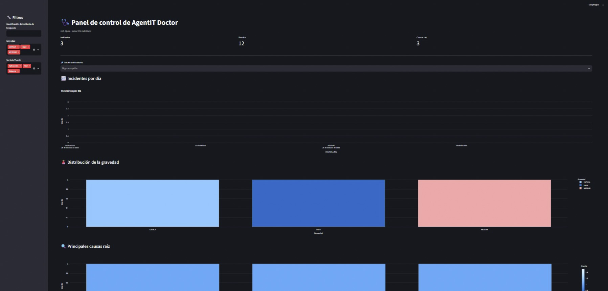
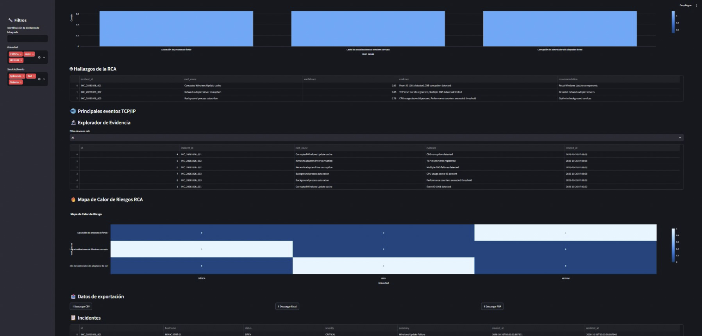
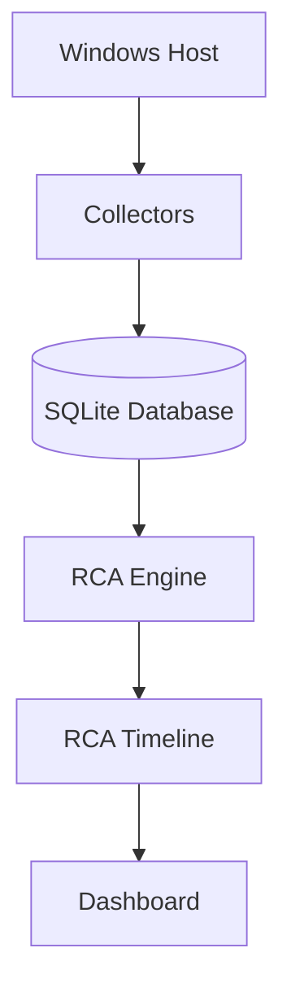

# 🩺 AgentIT Doctor

AI-Powered Windows Diagnostics & Root Cause Analysis Platform

## Overview

AgentIT Doctor is an intelligent Windows diagnostics platform that automates evidence collection, incident analysis, event correlation, and Root Cause Analysis (RCA).

The platform helps IT support teams identify issues faster, understand their impact, and generate actionable recommendations through an interactive dashboard.

---

## Features

✅ Windows Diagnostics

✅ Incident Detection

✅ Evidence Collection

✅ Evidence Persistence (SQLite)

✅ Root Cause Analysis Engine

✅ Event Correlation

✅ RCA Timeline Visualization

✅ Risk Score Analysis

✅ Interactive Dashboard

✅ PDF Export

---
## 📸 Screenshots

### Dashboard



### RCA Timeline


### Evidence Explorer


---

## Architecture



---

## Project Structure

```text
app/
├── agents/
├── dashboard/
├── database/
├── services/

tests/
docs/
migrations/
storage/
```

---

## Technology Stack

- Python 3.11+
- SQLite
- Streamlit
- Plotly
- Pytest

---

## Quick Start

### Clone Repository

```bash
git clone https://github.com/giovospo/agentit-doctor.git
cd agentit-doctor
```

### Install Dependencies

```bash
pip install -r requirements.txt
```

### Run Dashboard

```bash
streamlit run dashboard/dashboard_main.py
```

---

## Testing

```bash
pytest
```

---

## Roadmap

### v0.10.0

- RCA Timeline
- Evidence Explorer
- Dashboard Improvements

### v0.11.0

- AI Correlation Engine
- Advanced Analytics
- PDF RCA Reports

### v1.0.0

- Multi-host Diagnostics
- REST API
- Docker Deployment
- Windows Agent

---

## License

MIT Licensegit diff README.md